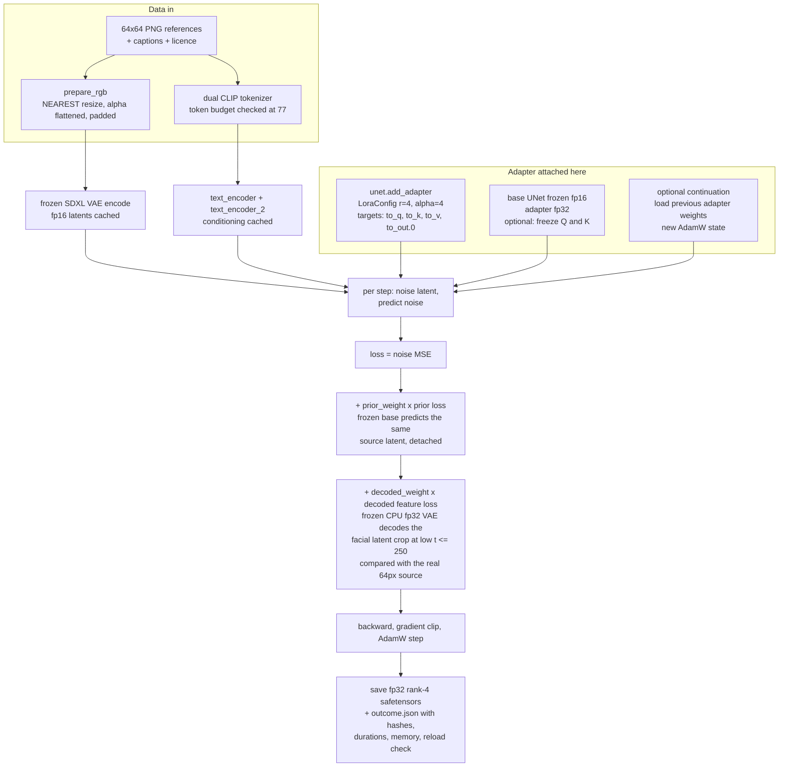
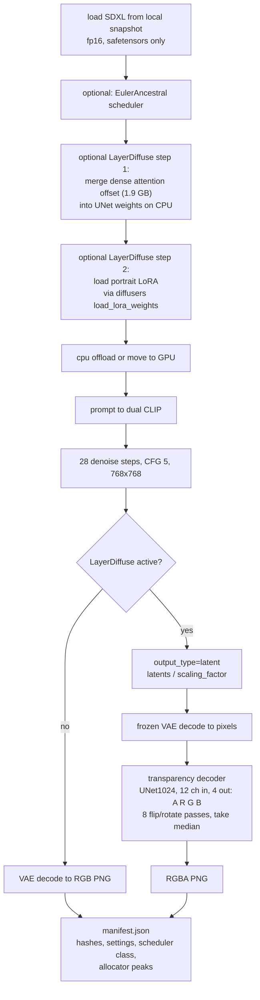
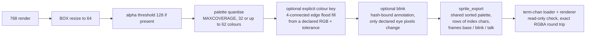
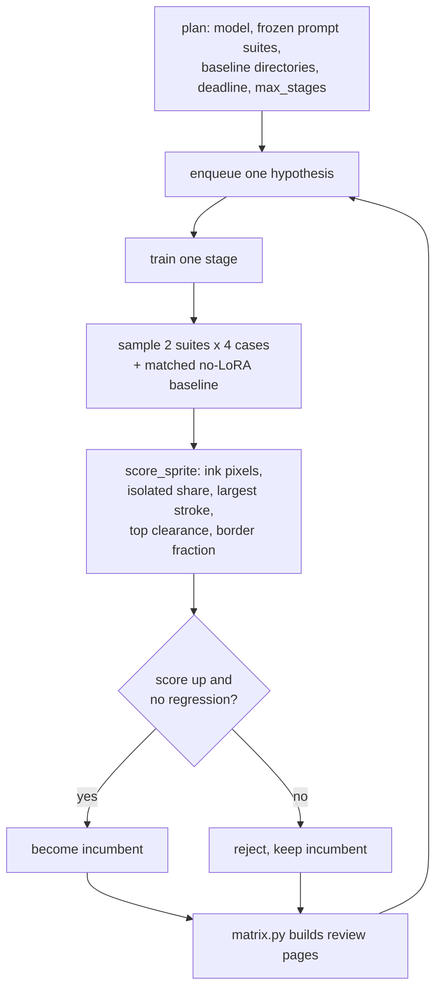

# Haremizer pipelines

How a text description becomes a 64×64 term-chan sprite, and where every adapter and every
deterministic step fits. Five segments: training, inference, post-processing, the evaluation loop, and
the adapter inventory.

Code entry points referenced below:

| file | role |
|---|---|
| `smoke_sdxl.py` | LoRA training (`--refine`) |
| `sample.py` | inference, optional LoRA and LayerDiffuse |
| `layerdiffuse.py` | LayerDiffuse offset merge and CPU transparency decoder |
| `recovery.py` | explicit background colour key |
| `blink.py` | hash-bound eye-region blink edit |
| `sprite_export.py` | term-chan sprite JSON export |
| `refinement_loop.py` | bounded stage coordinator |
| `auto_loop.py` | unattended driver over a hypothesis list |
| `score_sprite.py`, `ink_stats.py` | deterministic scoring |
| `matrix.py` | side-by-side review pages |

## 1. Training



Bounds applied at every stage: 900 seconds, 11 GiB allocator check, owned process group, storage
ceiling, and the plan's deadline and stage cap. Inputs are hash-pinned: model manifest, image bytes,
source pages, captions, groups and configuration.

## 2. Inference — where each adapter slots in



Order matters: the LayerDiffuse offset is merged **before** the style LoRA is loaded, so the two do not
fight over the same tensors. Example command:

```sh
sample.py --model <snapshot> --output <new dir> --prompt "..." --width 768 --height 768 \
  --steps 28 --guidance-scale 5 --cpu-offload --scheduler euler_ancestral \
  --lora <adapter.safetensors> --lora-sha256 <sha> \
  --layerdiffuse models/layerdiffuse
```

## 3. Post-processing — from render to term-chan sprite



This segment contains no learning. It is where the current kawaii sprite gets its transparency, since
native alpha did not separate the subject for that prompt. A colour key is labelled background
recovery, not native transparency.

## 4. The evaluation loop



One GPU job at a time. A stage that finishes but was not yet recorded is picked up again after a driver
restart. `matrix.py` writes `page-NN.png` with eight columns: column 1 is always the matched no-LoRA
render, later columns are training stages, and the native-64 rendition sits under each 768 render.

## 5. Adapter inventory

| artifact | what it is | size | where it attaches | who made it |
|---|---|---|---|---|
| **Style LoRA** | rank-4 bypass on UNet attention (`to_q`, `to_k`, `to_v`, `to_out.0`) | ~23 MB | loaded by diffusers `load_lora_weights` at inference; `add_adapter` at training | us, e.g. experiment 27, stage 6, stage 22 |
| **LayerDiffuse attention offset** | dense delta for SDXL attention weights, not a LoRA | 1.9 GB | added into UNet weights on CPU before the style LoRA | third party, hash-pinned |
| **LayerDiffuse transparency decoder** | separate UNet1024 network, 12 channels in, 4 out | 208 MB | after the VAE decode, produces alpha | third party, hash-pinned |
| **SDXL VAE** | the base model's VAE | part of the snapshot | frozen in training for the decoded loss, and at inference for decoding | Animagine XL 4.0 |
| **Frozen base UNet + dual CLIP** | 2.5B parameters | snapshot | never trained; supplies the prior loss and all conditioning | Animagine XL 4.0 |

## Two things worth knowing

**Training and inference touch the UNet differently.** Training inserts trainable rank-4 matrices into
attention and keeps everything else frozen. Inference can additionally fuse the LayerDiffuse offset
straight into the base weights. That is a different mechanism from a LoRA even though both change the
same layers.

**The sprite pipeline is separate from the model.** Everything in segment 3 is deterministic CPU code:
resizing, palette, colour key, blink, export. Model quality and sprite legibility are therefore
separately testable, and a rejected adapter can still produce a usable sprite.
