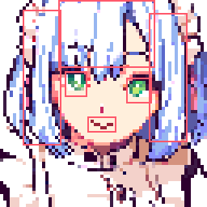
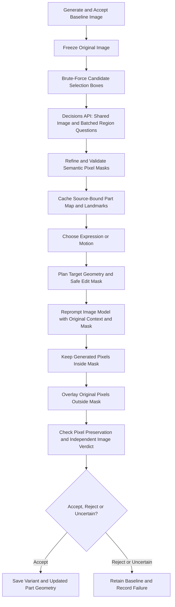

# Image World Model Approximation

<table>
  <tr>
    <td align="center" valign="top" width="33%">
      
<strong>01 · Accept baseline</strong>

      
    </td>
    <td align="center" valign="top" width="33%">
      
<strong>02 · Propose boxes</strong>

      
    </td>
    <td align="center" valign="top" width="33%">
      
<strong>03 · Classify regions</strong>

      
    </td>
  </tr>
  <tr>
    <td align="center" valign="top" width="33%">
      
<strong>04 · Plan safe edit</strong>

      
    </td>
    <td align="center" valign="top" width="33%">
      
<strong>05 · Regenerate part</strong>

      
    </td>
    <td align="center" valign="top" width="33%">
      
<strong>06 · Overlay and review</strong>

      
    </td>
  </tr>
</table>

Region labels are illustrative, not automatic detections. White mask pixels are editable; the final result retains original pixels everywhere else.

[Standalone overview](image-world-model.html)

## Flowchart

